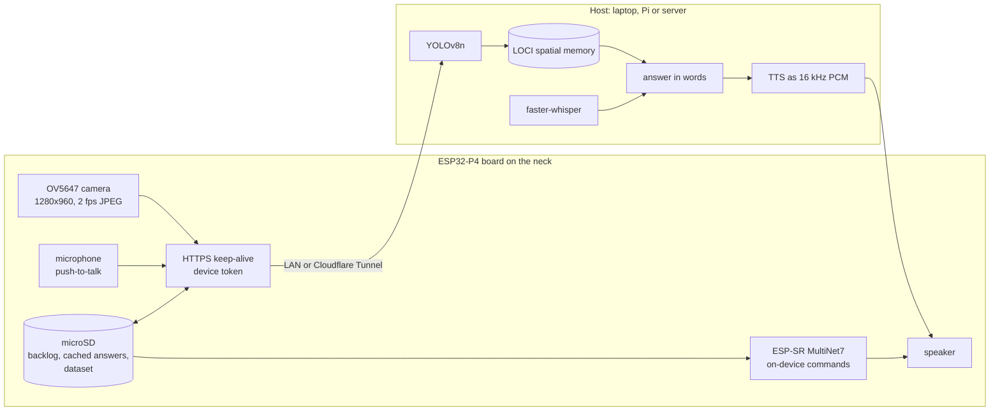

<p align="center">
  
</p>

<p align="center">
  <b>Spatial memory for Physical AI.</b><br>
  Robots, drones, wearables and world models remember <i>what</i> they saw, <i>where</i> and <i>when</i>, and notice what's new.
</p>

<p align="center">
  <a href="https://github.com/zd87pl/loci-db/actions/workflows/ci.yml"></a>
  <a href="https://pypi.org/project/loci-stdb/"></a>
  <a href="https://www.python.org/downloads/"></a>
  <a href="LICENSE"></a>
  <a href="docs/MCP_SERVER.md"></a>
  <a href="firmware/esp32-p4-client/"></a>
  <a href="https://github.com/zd87pl/loci-db/stargazers"></a>
</p>

<p align="center">
  <a href="#quick-start">Quick start</a> ·
  <a href="#three-demos-you-can-run-today">Demos</a> ·
  <a href="#the-pendant-a-spatial-memory-you-can-wear">The pendant</a> ·
  <a href="#how-it-works">How it works</a> ·
  <a href="#performance">Performance</a> ·
  <a href="#faq">FAQ</a> ·
  <a href="ROADMAP.md">Roadmap</a>
</p>

<p align="center">
  
  <br>
  <sub>A warehouse robot builds memory as it patrols, then answers <i>"what happened in this aisle?"</i> and <i>"where have I seen this before?"</i> Runs locally in about 30 seconds: <a href="#three-demos-you-can-run-today">run the demo</a>.</sub>
</p>

---

## In one minute

LOCI is three things that fit together:

1. **A library.** `pip install loci-stdb` gives any embedding an address in space and time, with one query that combines *similarity*, *where* and *when*, plus a calibrated **"is this new?"** score. In-process by default; [Qdrant](https://qdrant.tech) when you need persistence and scale.
2. **A working assistant.** Point a camera around a room and ask out loud *"where did I leave my cup?"* The answer comes from the memory, not from guessing: *"Your cup was last seen in the center, in the middle area. That was 3 hours ago. It's to the left of the scissors."*
3. **A device.** An ESP32-P4 board (listed from about US$19, camera kits for more) with a camera and a speaker runs that assistant as a thin client, keeps working from a microSD card and an on-device speech recogniser when the network is gone, and reaches its host anywhere through a Cloudflare Tunnel. It is the prototype of a **pendant for blind and visually impaired people**, and everything about it is in this repository.

No cloud account is required for any of the three. Camera frames never leave your LAN unless you choose to publish the host.

## Why LOCI?

Physical AI runs on memory. A robot that forgets where it saw the pallet, a drone that can't tell what changed since yesterday's flight, a person who can't see where the keys went: each needs to remember **what** was perceived, **where**, and **when**.

Vector databases store the *what*. LOCI stores all three, indexes them together, and answers the questions embodied systems actually ask:

| The question | The LOCI call |
|:--|:--|
| *"Where did I last see the red toolbox?"* | `query(vector)` returns the matching memory with its `(x, y, z, t)` |
| *"What happened in aisle 3 in the last 10 minutes?"* | `query(vector, spatial_bounds=..., time_window_ms=...)` |
| *"Is what I'm about to see new?"* | `predict_and_retrieve(...)`, which returns a **novelty score** in `[0, 1]` |
| *"How did I get here?"* | `get_trajectory(...)` / `get_causal_context(...)` |

|  | Plain vector DB | LLM agent memory | **LOCI** |
|:--|:--|:--|:--|
| Built for | any embedding | chat and text facts | **sensor and world-model embeddings in space and time** |
| `(x, y, z, t)` as a first-class index | payload filters you wire up yourself | not applicable | **Hilbert-bucketed 4D address** |
| Space + time + similarity in one call | DIY | not applicable | **one `query(...)`** |
| "Is this new?" | not built in | not built in | **calibrated novelty score** |
| Trajectories and causal links | not built in | not built in | **built in** |
| Memory that ages gracefully | TTL / delete | varies | **episodic → summary consolidation, bounded storage** |
| Infra needed to try it | a server | varies | **none** (in-process), or Qdrant for production |

## Quick start

No server, no Docker, no GPU:

```bash
pip install loci-stdb
```

```python
import time
import numpy as np
from loci import LocalLociClient, WorldState

rng = np.random.default_rng(0)
memory = LocalLociClient(vector_size=64)  # in-process: no server, no Docker

# A robot drives down a corridor. Each step it stores WHAT it sees
# (any embedding: CLIP, DINOv2, V-JEPA 2, ...), WHERE, and WHEN.
t0 = int(time.time() * 1000)
mug = rng.normal(size=64)
for step in range(100):
    seen = mug if step == 42 else rng.normal(size=64)  # passes a mug at step 42
    memory.insert(WorldState(
        x=step / 100, y=0.5, z=0.0,          # where (normalised to [0, 1])
        timestamp_ms=t0 + step * 100,         # when
        vector=seen.tolist(),                 # what
        scene_id="corridor",
        metadata={"step": step},
    ))

# "Where did I see this mug?"
hit = memory.query(vector=mug.tolist(), limit=1)[0]
print(f"mug seen at x={hit.x:.2f}, step {hit.metadata['step']}")   # x=0.42, step 42

# "What did I see in this part of the corridor, in the first 5 seconds?"
region = {"x_min": 0.3, "x_max": 0.5, "y_min": 0, "y_max": 1, "z_min": 0, "z_max": 1}
recent = memory.query(vector=mug.tolist(), spatial_bounds=region,
                      time_window_ms=(t0, t0 + 5_000), limit=3)

# "Is this new?" Novelty is 0 for familiar scenes and close to 1 for unseen ones.
for name, view in [("the mug", mug), ("something new", rng.normal(size=64))]:
    r = memory.predict_and_retrieve(context_vector=view.tolist(), predictor_fn=lambda v: v,
                                    current_position=(0.42, 0.5, 0.0))
    print(f"{name}: novelty={r.prediction_novelty:.2f}")   # the mug: 0.00, something new: 0.69
```

Swap `LocalLociClient` for `LociClient("http://localhost:6333", ...)` to use the same code on a persistent Qdrant backend (see [Production setup](#production-setup)).

## Three demos you can run today

| | What it shows | Run it |
|:--|:--|:--|
| **Warehouse robot** (the GIF above) | A simulated robot patrols, builds memory, then answers place-and-time and similarity questions. Five guided steps, in-process, no keys. | `pip install -e . fastapi "uvicorn[standard]"` then `uvicorn demo.app.main:app` and open `http://localhost:8000` |
| **Room assistant** ([`demo_spatial/`](demo_spatial/)) | Your phone's camera watches a room; you ask out loud where things are. Local Whisper for speech in, local or edge TTS for speech out; a VLM is optional. | `demo_spatial/run_demo.sh` and open the HTTPS URL it prints on your phone |
| **Handheld** ([design](docs/HANDHELD_DEMO_DESIGN.md)) | Raspberry Pi 5 + OAK-D Lite: stereo depth gives objects metric positions, AprilTags anchor rooms, answers say *"on the kitchen table"*. | `deploy/handheld/` |
| **Pendant thin client** ([docs](docs/ESP32_THIN_CLIENT_DEMO.md), [firmware](firmware/esp32-p4-client/)) | An ESP32-P4 board streams frames to a host that runs YOLO, LOCI and voice; answers play from the board's speaker. Works offline from its microSD card. | `demo_spatial/run_esp32_demo.sh` on the host, `idf.py flash` on the board |

The assistant demos share one backend ([`demo_spatial/app/`](demo_spatial/app/)): camera frames become detections, detections become LOCI observations with a place and a time, and questions are answered from that memory in plain language with relative positions (*"to the left of the scissors"*) and elapsed time (*"3 hours ago"*).

## The pendant: a spatial memory you can wear

The question that started this repository was not about robots. It was *"where did I put my cup?"*, asked by people who cannot see the cup. A phone in the hand is not an answer to that; something worn and hands-free is. So the room assistant was shrunk onto a board you can hang around a neck.



**What the prototype does today** (Waveshare ESP32-P4-NANO: ESP32-P4, 32 MB PSRAM, OV5647 camera, ES8311 codec with speaker and microphone, ESP32-C6 for Wi-Fi):

- Streams 1280×960 frames to the host at 2 fps over one keep-alive connection, with the host running detection, the LOCI memory, speech-to-text and text-to-speech. Nothing heavy runs on the board.
- Push the button, ask *"where is my cup?"*, and the answer plays from the board's speaker about 1.3 s after you let go.
- **Loses the network and keeps working.** Frames are stored on the microSD card and uploaded later with their original timestamps, so the memory has no holes. The spoken summary of the memory and one spoken answer per remembered object are cached on the card. An on-device recogniser (Espressif's MultiNet7, no wake word, no cloud) understands *"where is my cup"* for every remembered object and plays the cached answer, host or no host.
- **Reaches its host from anywhere.** The host sits behind a Cloudflare Tunnel; the board talks HTTPS with a device token and switches between the LAN address and the public hostname from its console, no reflash. From outside the LAN only the board's endpoints exist; the rest of the demo stays private.
- Records every Nth frame with its detections as a training set, and a tool turns that into a YOLO dataset to fine-tune a detector on *your* objects.

**Measured on the desk** (all numbers from the logs, details in the [thin-client doc](docs/ESP32_THIN_CLIENT_DEMO.md) and the [board README](firmware/esp32-p4-client/README.md)):

| Path | Result |
|:--|:--|
| Frame round trip on the LAN | 70 to 240 ms per 110 to 140 kB frame |
| Frame round trip through the Cloudflare Tunnel | about 200 to 400 ms, TLS verified against the IDF certificate bundle |
| Host detection | YOLOv8n, 74 ms per frame at inference size 960 on an M-series laptop |
| Typed or spoken question, answer playing on the board | about 1.3 s after the question |
| On-device recognition with the host switched off | *"where is my cup"* recognised with p = 0.81 in 730 ms on 4 s of audio, cached answer played from the card |
| Outage | frames to the card, uploaded on reconnect; six hundred backlog frames drained while live frames kept flowing |

**What it is not yet.** This is a development board with a camera ribbon, not a product: no enclosure, no battery measurement, no clinical or user study. The detector knows the 80 COCO classes, so it finds cups and scissors but not keys or glasses; open-vocabulary detection is the next quality step. The next hardware stage is a phone-tethered pendant, then a standalone one on LTE.

**If you would wear one, or build one.** Everything needed to reproduce the prototype is here: firmware, host, protocol, pin maps, the pitfalls we hit on the way (several of them in ESP-IDF itself). Tell us in [Discussions](https://github.com/zd87pl/loci-db/discussions) what you would need from a pendant; that conversation decides whether this becomes a kit or a crowdfunded device.

## How it works

LOCI is a memory layer on top of [Qdrant](https://qdrant.tech), with an in-process backend for zero-infra use. Three primitives make space and time first-class:

### 1. Multi-resolution Hilbert bucketing

`(x, y, z, t)` is encoded on a 4D Hilbert curve at several resolutions (p = 4,
8, 12). A spatial bounding box becomes an integer pre-filter on the curve,
combined in the same backend filter with exact coordinate, time and
confidence range conditions so top-k is selected only among eligible points;
an exact payload post-filter is the final geometric check, so there are no
false negatives at box boundaries. With `adaptive=True`, dense regions are
promoted to finer resolutions at query time.

```
         Naive Qdrant               LOCI
    ┌──────────────────┐     ┌──────────────────┐
    │ x_min ≤ x ≤ x_max│     │                  │
    │ y_min ≤ y ≤ y_max│ →   │ hilbert_r4 ∈ {…} │
    │ z_min ≤ z ≤ z_max│     │ + exact ranges   │
    └──────────────────┘     └──────────────────┘
```

### 2. Bounded storage that ages like memory

All raw states live in one **`loci_data`** collection and consolidated summaries in one **`loci_summary`** collection, so the collection count stays fixed however long you ingest. Epochs (default 5 s) are **logical**: the unit of consolidation and of Hilbert t-normalisation. Time-windowed queries use an indexed `timestamp_ms` range filter. With a `ConsolidationPolicy`, old episodes fold into per-scene summaries instead of being deleted: recent memory stays sharp, old memory becomes gist, and storage stays bounded.

### 3. Predict-then-retrieve with novelty detection

One atomic call composes your world model with memory search and returns analogs plus a **novelty score**:

```python
result = client.predict_and_retrieve(
    context_vector=current_embedding,
    predictor_fn=my_world_model,
    future_horizon_ms=2000,
    current_position=(0.5, 0.3, 0.8),
)
print(f"Novelty: {result.prediction_novelty:.2f}")
# 0.0 = "I've seen this before"
# 1.0 = "This is new territory"
```

By default this searches stored history for analogs of the predicted future. Pass `search_time_window_ms=(start, end)` to restrict retrieval to an absolute time range.

### Architecture

```
┌───────────────────────────────────────────────┐
│              Application Layer                │
│  LociClient / AsyncLociClient / LocalLociClient│
│  insert · query · predict_and_retrieve        │
│  REST server · MCP server · CLI               │
│  demos: warehouse · room assistant · pendant  │
├───────────────────────────────────────────────┤
│              Retrieval Layer                  │
│  predict.py — predict-then-retrieve + novelty │
│  funnel.py  — multi-scale coarse→fine search  │
├───────────────────────────────────────────────┤
│           Indexing & Routing Layer            │
│  spatial/  — multi-res Hilbert + overlap      │
│  temporal/ — logical epochs: consolidation,   │
│              retention, decay scoring         │
├───────────────────────────────────────────────┤
│              Adapters Layer                   │
│  V-JEPA 2 · DreamerV3 · Generic numpy/torch  │
├───────────────────────────────────────────────┤
│              Storage Layer                    │
│  Qdrant — two bounded collections per tenant: │
│    loci_data (raw) + loci_summary (aged)      │
│  MemoryStore (in-process, no infra needed)    │
└───────────────────────────────────────────────┘
```

See [ARCHITECTURE.md](ARCHITECTURE.md) for the full design.

## Performance

We publish what we measure, including where LOCI loses. All numbers below come straight from `benchmarks/results/retrieval_latest.json` (in-memory `LocalLociClient` backend, 128-dim vectors, 500 queries per scenario, seed 42, Apple Silicon / arm64, Python 3.14). Latency depends heavily on query type: **label-filtered retrieval (a `scene_id` keyword filter with no spatial or temporal bounds, the demo path) runs at ~78 µs p50 at N=100**, while spatial bounding-box queries are dominated by the exact geometric post-filter and take tens to hundreds of milliseconds at these dataset sizes.

| N objects | Query type | P50 | P99 |
|--:|:--|--:|--:|
| 100 | Label-filtered (`scene_id` keyword, no spatial/temporal bounds) | 78 µs | 101 µs |
| 100 | Vector-only ANN | 195 µs | 252 µs |
| 100 | Spatial + temporal window | 40.0 ms | 43.6 ms |
| 100 | Spatial bounding box | 97.5 ms | 108.0 ms |
| 1,000 | Label-filtered | 479 µs | 524 µs |
| 1,000 | Vector-only ANN | 1.67 ms | 1.92 ms |
| 1,000 | Spatial + temporal window | 297 ms | 309 ms |
| 1,000 | Spatial bounding box | 580 ms | 636 ms |

Adding a temporal window to a spatial query roughly halves its cost through indexed time-range filtering (40.0 ms vs 97.5 ms p50 at N=100), but the exact spatial post-filter dominates spatial query time in the pure-Python in-memory backend. Accelerating that path is the motivation for the optional native Rust primitives in `loci-core/`.

Insert throughput: **~60,000 to 67,000 states/s** (in-memory backend, 128-dim vectors).

```bash
python benchmarks/benchmark_retrieval.py          # retrieval benchmark on your hardware
python benchmarks/world_model_harness.py --quick  # world-model proof harness
python benchmarks/vs_naive_qdrant.py              # LOCI vs naive Qdrant (in-memory)
QDRANT_URL=http://localhost:6333 python benchmarks/vs_naive_qdrant.py  # against a live server
```

Results are written to `benchmarks/results/` and printed as markdown tables. See [docs/BENCHMARK_METHODOLOGY.md](docs/BENCHMARK_METHODOLOGY.md) for the replication guide and [RFC-0001](docs/RFC-0001-memory-for-world-models.md) for where we think the real moat is.

<details>
<summary><b>How does LOCI compare to SpatCode and TANNS?</b></summary>

**SpatCode** (WWW 2026, arXiv 2601.09530) encodes coordinates into the embedding space for soft/fuzzy retrieval via RoPE-style positional encoding. LOCI uses Hilbert bucketing for **exact geometric range queries** with deterministic behavior. Use SpatCode when semantic proximity matters (e.g. "find images taken near this location"). Use LOCI when physical boundaries matter (e.g. "find all observations within this 3D bounding box in the last 5 seconds").

**TANNS** (ICDE 2025) builds a single graph managing all timestamps internally with a Timestamp Graph structure. LOCI uses payload-indexed time filtering over a bounded raw + summary collection pair, with episodic-to-semantic consolidation as data ages. Use TANNS for single-session temporal ANN where all data fits in one graph. Use LOCI when you need cross-session persistence, multi-agent memory sharing, bounded-storage memory aging, or predict-then-retrieve.

More in [docs/NOVELTY.md](docs/NOVELTY.md).
</details>

## What you can build

- **Assistive wearables**: *"where did I leave my keys?"*, answered from memory, hands-free (see [the pendant](#the-pendant-a-spatial-memory-you-can-wear)).
- **Robot fleets and warehouses**: shared memory of where things are, plus *"what changed since the last patrol?"*
- **Drones and inspection**: geo-temporal recall of defects and anomalies across flights.
- **Autonomous vehicles and mobile robots**: retrieve scenes by place and time for replay, debugging, and edge-case mining.
- **World models** (V-JEPA 2, DreamerV3, ...): predict-then-retrieve memory for imagination rollouts, with a novelty signal for safety monitors and exploration.
- **LLM agents with a body**: give Claude or any MCP client a spatial memory.

## MCP server: spatial memory for agents

LOCI ships a [Model Context Protocol](https://modelcontextprotocol.io) server, so Claude Desktop, Claude Code, or any MCP client gets five tools: `remember`, `recall`, `novelty`, `trajectory`, and `memory_stats`.

```bash
pip install "loci-stdb[mcp]"
claude mcp add loci-memory --env LOCI_MCP_MODE=local -- loci-mcp
```

Backends: `local` (in-memory), `qdrant` (persistent), or `cloud`. See [docs/MCP_SERVER.md](docs/MCP_SERVER.md) for Claude Desktop config, the env table, the tool reference, and agent recipes.

## Production setup

<details>
<summary><b>Docker (REST API + Qdrant)</b></summary>

```bash
docker compose up
```

This starts the LOCI REST API on `http://localhost:8000` (interactive docs at `/docs`) and Qdrant on `http://localhost:6333`, with Qdrant data persisted in a named volume.

```bash
# Health check
curl http://localhost:8000/health

# Insert a world state. The vector length must match the server's
# LOCI_VECTOR_SIZE (512 in docker-compose.yml). Wrong-length vectors are
# rejected with HTTP 422, so the payload is generated rather than hand-typed:
python3 -c 'import json; print(json.dumps({
    "x": 0.5, "y": 0.3, "z": 0.8,
    "timestamp_ms": 1700000000000,
    "vector": [0.1] * 512,
    "scene_id": "s1"}))' \
  | curl -X POST http://localhost:8000/insert \
      -H 'Content-Type: application/json' -d @-

# Query by vector similarity. Spatial bounds and the time window are optional;
# omit them to search everything:
python3 -c 'import json; print(json.dumps({
    "vector": [0.1] * 512,
    "x_min": 0.0, "x_max": 1.0, "y_min": 0.0, "y_max": 1.0,
    "z_min": 0.0, "z_max": 1.0,
    "limit": 10}))' \
  | curl -X POST http://localhost:8000/query \
      -H 'Content-Type: application/json' -d @-
```
</details>

<details>
<summary><b>Python client on Qdrant</b></summary>

```bash
pip install loci-stdb
docker run -p 6333:6333 qdrant/qdrant
```

```python
from loci import LociClient, WorldState

client = LociClient(
    "http://localhost:6333",
    vector_size=512,
    epoch_size_ms=5000,
    distance="cosine",
)

# Insert world states
state = WorldState(
    x=0.5, y=0.3, z=0.8,
    timestamp_ms=1700000000000,
    vector=[0.1] * 512,
    scene_id="warehouse_sim",
    scale_level="patch",
)
state_id = client.insert(state)

# Batch insert (one bulk Qdrant upsert)
ids = client.insert_batch(states)

# Spatiotemporal query with overlap factor
results = client.query(
    vector=query_embedding,
    spatial_bounds={"x_min": 0.2, "x_max": 0.8,
                    "y_min": 0.0, "y_max": 1.0,
                    "z_min": 0.0, "z_max": 1.0},
    time_window_ms=(start_ms, end_ms),
    limit=10,
    overlap_factor=1.2,  # 20% expanded search for boundary recall
)

# Predict-then-retrieve with novelty scoring
result = client.predict_and_retrieve(
    context_vector=current_embedding,
    predictor_fn=my_world_model,
    future_horizon_ms=2000,
    current_position=(0.5, 0.3, 0.8),
)

# Trajectory reconstruction via scroll API
trajectory = client.get_trajectory(state_id, steps_back=20, steps_forward=20)

# Episodic context window
context = client.get_causal_context(state_id, window_ms=5000)
```

Upgrading a deployment created before the bounded two-collection layout? Run `loci migrate-layout --qdrant-url http://localhost:6333` once (see [CHANGELOG.md](CHANGELOG.md); this was a breaking storage-layout change).
</details>

<details>
<summary><b>Async API and world-model adapters</b></summary>

```python
from loci import AsyncLociClient

async with AsyncLociClient(
    "http://localhost:6333",
    vector_size=512,
    distance="cosine",
) as client:
    await client.insert(state)
    results = await client.query(vector=query_embedding, limit=10)
```

```python
from loci.adapters.vjepa2 import VJEPA2Adapter
from loci.adapters.dreamer import DreamerV3Adapter
from loci.adapters.generic import GenericAdapter

# V-JEPA 2
adapter = VJEPA2Adapter()
states = adapter.batch_clip_to_states(clip_output, ts, scene_id)

# DreamerV3
adapter = DreamerV3Adapter()
ws = adapter.rssm_to_world_state(h_t, z_t, position, ts, scene_id)

# Generic numpy/torch
adapter = GenericAdapter(expected_dim=512)
ws = adapter.from_numpy(embedding, position, ts, scene_id)
```

These helpers convert model outputs you already have into `WorldState`
objects; they do not load or run a model. The V-JEPA 2 helper maps tubelet
grid indices to normalised coordinates, not calibrated 3D positions, so your
application defines and validates that mapping.

See [docs/WORLD_MODEL_INTEGRATION.md](docs/WORLD_MODEL_INTEGRATION.md) for
integration guides.

## Performance

## FAQ

**Isn't this just a vector database with a few payload filters?**
You can build the first 20 % with payload filters, and we did. The rest is what the filters don't give you: a 4D Hilbert pre-filter that keeps the geometric range query exact, a novelty score calibrated against what the memory has already seen, consolidation that turns old episodes into summaries instead of deleting them, and trajectory and causal links between observations. The [comparison table](#why-loci) is the honest version of this answer.

**Does my camera stream go to the cloud?**
Not unless you publish the host. The demos run on your laptop or Pi; frames stay on the LAN. The pendant's optional online mode publishes only the board's endpoints through a Cloudflare Tunnel, behind a device token, and the board falls back to its card and on-device recogniser when that link is gone.

**Do I need a GPU?**
No. The in-process library is pure Python with optional Rust primitives, the demos run YOLOv8n and faster-whisper on a laptop CPU, and the board does nothing heavy at all.

**Is it a product or a library?**
A library first (Apache 2.0, on PyPI), with reference demos and one piece of reference hardware. Whether the pendant becomes a kit or a device is being decided in the open; see [Discussions](https://github.com/zd87pl/loci-db/discussions).

**What does it cost to build the pendant prototype?**
One Waveshare ESP32-P4-NANO (the maker lists the bare board from about US$19 and the kits with the OV5647 camera up to about US$87), a microSD card and a small 8 Ω speaker. The host is any laptop, a Raspberry Pi 5, or a small server.

**How mature is it?**
Alpha. 1,300+ tests, CI on Python 3.11 and 3.12, a changelog that records breaking changes (there was one in 0.4, with a migration command). Read [docs/IMPLEMENTATION_READINESS.md](docs/IMPLEMENTATION_READINESS.md) before you bet a deployment on it.

## Roadmap and contributing

LOCI is young, and the most useful contributions right now are **integrations with the tools physical-AI builders already use** and **eyes on the pendant**:

- an **open-vocabulary detector** path (YOLO-World, OWLv2) so *"where are my keys"* works for objects COCO never heard of
- a **ROS 2** node that turns odometry + camera embeddings into LOCI memories
- a **LeRobot** dataset loader and policy-memory example
- **NVIDIA Isaac Sim** and **Habitat** examples with real embeddings
- a **world-model memory benchmark** ([RFC-0001](docs/RFC-0001-memory-for-world-models.md) R3)
- for the pendant: event-driven capture for cellular links, a wake word, battery measurements, an enclosure

Pick one up, open an issue to discuss it, or see [CONTRIBUTING.md](CONTRIBUTING.md) and [ROADMAP.md](ROADMAP.md).

```bash
git clone https://github.com/zd87pl/loci-db.git
cd loci-db
pip install -e ".[dev]"
pytest tests/ -v

# Linting & formatting (must pass in CI)
ruff check loci/ tests/
ruff format --check loci/ tests/
mypy loci/
```

## Why "LOCI"?

The [method of loci](https://en.wikipedia.org/wiki/Method_of_loci) is the 2,500-year-old memory-palace technique: you remember things by placing them somewhere in space and walking back to them later. LOCI does the same for machines. Every memory has a place and a time, and that address is how you find it again.

## Documentation

- [ARCHITECTURE.md](ARCHITECTURE.md): system design
- [docs/ESP32_THIN_CLIENT_DEMO.md](docs/ESP32_THIN_CLIENT_DEMO.md): the pendant thin client, protocol and measurements
- [firmware/esp32-p4-client/README.md](firmware/esp32-p4-client/README.md): board facts, flashing, online mode, troubleshooting
- [docs/HANDHELD_DEMO_DESIGN.md](docs/HANDHELD_DEMO_DESIGN.md): the Pi 5 + OAK-D Lite handheld
- [docs/MCP_SERVER.md](docs/MCP_SERVER.md): MCP server reference
- [docs/WORLD_MODEL_INTEGRATION.md](docs/WORLD_MODEL_INTEGRATION.md): world-model integration guides
- [docs/NOVELTY.md](docs/NOVELTY.md): novelty claims vs prior art
- [docs/BENCHMARK_METHODOLOGY.md](docs/BENCHMARK_METHODOLOGY.md): benchmark replication guide
- [docs/IMPLEMENTATION_READINESS.md](docs/IMPLEMENTATION_READINESS.md): pilot scope, evidence and delivery gates
- [docs/RFC-0001-memory-for-world-models.md](docs/RFC-0001-memory-for-world-models.md): strategic direction

## Citation

If LOCI helps your research, please cite it (GitHub's **"Cite this repository"** button uses [CITATION.cff](CITATION.cff)):

```bibtex
@software{loci2026,
  title  = {LOCI: Spatial Memory for Physical AI},
  author = {Dyras, Zygmunt},
  year   = {2026},
  url    = {https://github.com/zd87pl/loci-db}
}
```

## License

Apache 2.0. Created by [Zygmunt Dyras](https://github.com/zd87pl).

If you're building for the physical world, or for someone who can't see it, **⭐ star the repo** to follow along. It genuinely helps other robotics, assistive-tech and world-model builders find LOCI.
